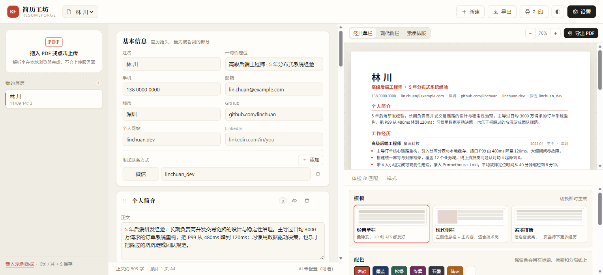
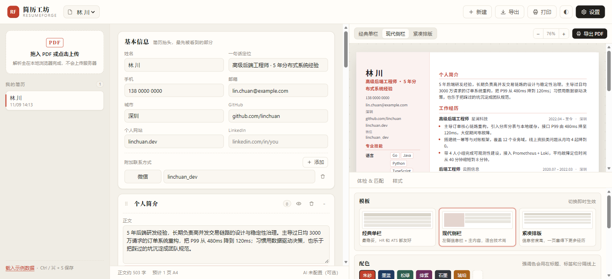

# 简历工坊 · ResumeForge

> 把一份已经写好的 PDF 简历，变成可以在浏览器里直接改、直接排、直接导出的结构化数据。

纯前端单页应用：**PDF 解析、编辑、A4 排版、导出全部在本机浏览器完成**，没有后端、没有账号、简历不上传任何服务器。



## 它解决什么问题

找工作的人手上几乎都有一份旧 PDF 简历。想改一句话、加一段经历，就得回到 Word 里重新排版，或者重做一个模板；在线简历工具又通常要求注册账号、把简历传到别人服务器上。

ResumeForge 反过来做：**先解析你已有的 PDF，再把内容还原成结构化的可编辑字段**，你在左边改字段，右边实时按 A4 排好版，最后导出 PDF / HTML / Markdown / JSON。

## 功能

- **PDF → 结构化数据**：提取文字层、按坐标聚行、识别左右双栏并重排、用章节词典切分「工作经历 / 项目经历 / 教育背景 / 专业技能 / 证书 / 荣誉 / 语言 / 简介」，再把日期、公司、职位、要点归位。
- **解析报告**：识别度评分、文本行/章节/条目/要点统计、警告与「未归入章节」的原始行，方便核对而不是盲信。
- **可视化编辑**：基本信息、章节拖拽排序、条目增删、要点逐条编辑、技能标签、附加联系方式；支持隐藏章节、AI 改写（可选）。
- **实时 A4 预览**：三套模板（经典单栏 / 现代侧栏 / 紧凑排版）、强调色、字号、行距、页边距、照片，自动适配预览宽度，带分页参考线。
- **原稿对照**：解析时留存的首页缩略图，随时和编辑结果对照。
- **简历体检**：缺联系方式、要点没有量化、弱动词开头、时间格式不统一、篇幅过长等，按严重程度列出。
- **岗位匹配度**：粘贴职位描述，本地计算关键词覆盖率与缺失关键词，不需要联网。
- **导出**：浏览器打印为 PDF（A4 精确分页）、单文件 HTML、Markdown、本工具 JSON、[JSON Resume](https://jsonresume.org/) 标准格式。
- **本地优先**：多份简历存在 `localStorage`，自动保存，`Ctrl/⌘ + S` 手动保存，可导出 JSON 备份与迁移。



## 快速开始

```bash
npm install
npm run dev          # http://127.0.0.1:5273
```

生产构建：

```bash
npm run build        # 产物在 dist/
npm run preview      # 本地预览构建结果
```

要求 Node 18+（开发时用的是 Node 24）。首次 `dev` / `build` 会自动把 `pdfjs-dist` 的 CMap 和标准字体拷到 `public/pdfjs/`，中文 PDF 缺了它们会解析成乱码。

## 部署到 GitHub Pages

仓库自带工作流 `.github/workflows/deploy.yml`，推到 `main` 即自动构建发布。

1. 新建仓库并推送本目录（`git init && git add . && git commit -m "init" && git push`）。
2. 仓库 **Settings → Pages → Source** 选 **GitHub Actions**。
3. 等 Actions 跑完，访问 `https://<用户名>.github.io/<仓库名>/`。

`vite.config.ts` 里 `base: './'`，所以子路径部署和直接打开 `dist/index.html` 都能用。

## 解析是怎么做的

`src/core/pdf.ts` → `src/core/parse.ts`：

1. **取文字层**：`pdfjs-dist` 逐页 `getTextContent()`，每个文本项有 `transform`（x/y/字号）和宽度。
2. **聚行**：同页按 y 聚类（容差 ≈ 0.45 倍字号），行内按 x 排序，按字间距决定是否插空格，中文之间不硬插空格。
3. **分栏**：按行起始 x 做聚类，若存在明显列间隙且两侧行数都够多，就判定双栏，把每行按列拆开、先左栏后右栏重排，避免两栏内容交错成乱句。
4. **切章节**：章节标题走词典（中英文别名 + 字号/加粗判断），命中后开启新块；同级重复标题合并。
5. **填字段**：条目头用「日期区间」定位，剩余文本按 `| ｜ · — 空格` 与公司/学校后缀切分公司与职位；条目正文按缩进、项目符号与折行规则归为要点；技能栏按「标签：内容」分组，短词变标签、长句变描述。
6. **兜底**：识别不到章节就整篇进「个人简介」；识别度低、有未归入的行都会写进解析报告，交给人来改。

启发式不可能 100% 命中，所以**编辑器的目标不是「解析完美」，而是「改起来比重写快」**。

## 数据结构

`src/core/types.ts` 定义了唯一的数据源：

```ts
ResumeData {
  schema: 'resume-forge/v1'
  profile: { name, headline, email, phone, location, website, github, linkedin, photo, extras[] }
  sections: [{ kind, title, visible, text, entries: [{ title, subtitle, start, end, location, link, tags[], bullets[] }] }]
  meta: { template, accent, fontScale, lineHeight, pageMargin, showPhoto }
}
```

导出 JSON 就是这个结构，导入同一份 JSON 即可恢复；`JSON Resume` 导出是给其它工具用的兼容层。

## 可选：接 AI 改写

设置里填任意 OpenAI 兼容接口（OpenAI / DeepSeek / 通义 / 本地 Ollama 都行），即可使用：

- 单条要点改写（动词开头 + 量化结果，禁止编造数字）
- 一键起草个人简介

Key 只存本机 `localStorage`，请求从浏览器直连你填的地址。不填也能用全部其它功能。

## 已知限制

- **扫描件 / 图片型 PDF 没有文字层**，解析会返回空内容并提示，需要先 OCR（路线图里）。
- 极复杂版式（表格、浮动文本框、艺术字）只能尽力而为，解析报告会标出未归入的行。
- 双栏识别基于列间隙，三栏或左右不对称排版可能判断失败。
- 没有 `.docx` 直接导入，先另存为 PDF。
- 浏览器打印导出 PDF 时，请在打印对话框里把「边距」设为无、勾选「背景图形」。

## 路线图

- [ ] 扫描件 OCR（tesseract.js，按需加载）
- [ ] docx 导入（mammoth）
- [ ] 更多模板与自定义区块排版
- [ ] 解析结果的手动修正映射（把未归入的行拖进章节）
- [ ] 英文简历的欧美版式优化

## 开发

```bash
npm run typecheck    # tsc --noEmit
npm run build        # 类型检查 + 生产构建
```

目录：

```
src/core/        解析、模板渲染、评分、导出、存储（纯逻辑，无 UI 依赖）
src/components/  编辑器、预览、体检、样式、设置
src/styles/      界面样式与打印规则
scripts/         pdfjs 资源拷贝
docs/            截图
samples/         示例数据
```

## 参考与致谢

设计时参考了几个成熟项目的思路：[Reactive Resume](https://github.com/AmruthPillai/Reactive-Resume)（编辑器与模板体系的完整度）、[OpenResume](https://github.com/xitanggg/open-resume)（浏览器端 PDF 解析 + 简历构建的产品形态）、[JSON Resume](https://jsonresume.org/)（数据交换标准）。本项目没有复用它们的代码，实现与数据模型都是自己的。

## License

MIT
